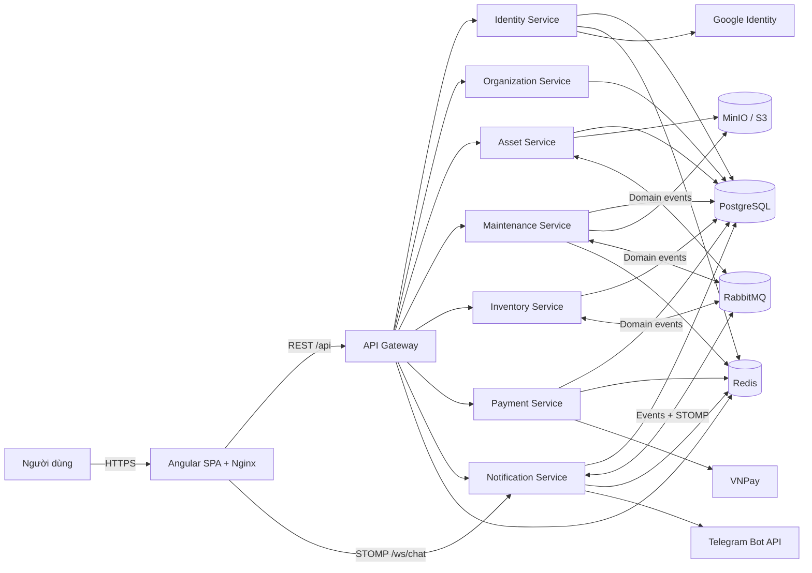
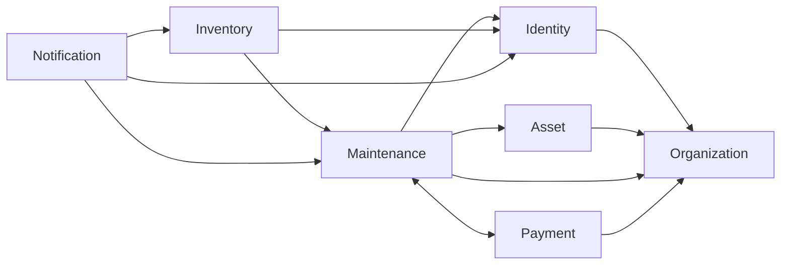
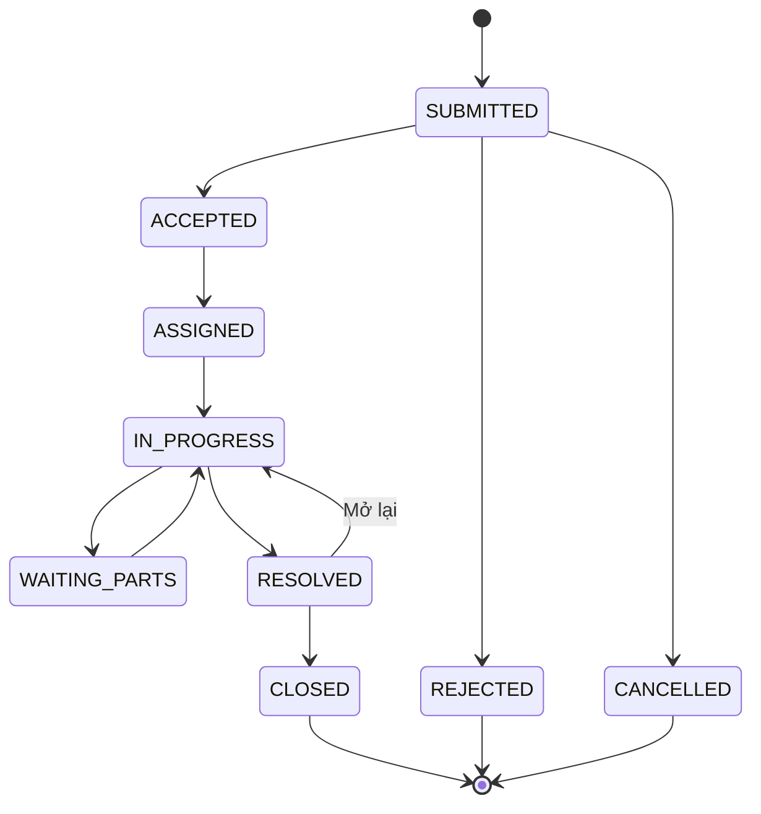

# Tổng quan hệ thống quản lý bảo trì thiết bị

> Tài liệu này mô tả kiến trúc và các luồng nghiệp vụ chính theo trạng thái mã nguồn ngày 19/10/2026. Hướng dẫn cấu hình chi tiết, migration và xử lý sự cố nằm trong [README.md](README.md).

## 1. Mục tiêu hệ thống

Hệ thống số hóa toàn bộ vòng đời bảo trì thiết bị: tiếp nhận yêu cầu, phân công kỹ thuật viên, theo dõi SLA, ghi nhận vật tư và chi phí, trao đổi theo phiếu, thanh toán, thông báo và báo cáo vận hành.

Đối tượng sử dụng chính:

- **ADMIN**: quản trị toàn hệ thống, tài khoản, cấu hình và nghiệp vụ.
- **MANAGER**: quản lý khách hàng, địa điểm, thiết bị, phiếu, chi phí, thanh toán và báo cáo.
- **TECHNICIAN**: tiếp nhận phiếu được giao, cập nhật tiến độ, nhật ký, linh kiện và chi phí.
- **REQUESTER/CUSTOMER**: tạo và theo dõi phiếu trong phạm vi được cấp, trao đổi, thanh toán và gửi phản hồi.

## 2. Chức năng chính

| Nhóm chức năng | Khả năng |
| --- | --- |
| Danh tính và truy cập | Đăng nhập bằng mật khẩu hoặc Google, refresh token, phân quyền theo vai trò và phạm vi khách hàng/địa điểm |
| Tổ chức | Quản lý khách hàng, địa điểm lắp đặt và vùng phụ trách |
| Tài sản | Quản lý loại thiết bị, thiết bị, bảo hành và tài liệu thiết bị |
| Bảo trì | Tạo phiếu, tiếp nhận, phân công, xử lý, SLA, nhật ký công việc và tệp đính kèm |
| Kho | Quản lý linh kiện, tồn kho, lịch sử xuất/nhập và linh kiện sử dụng cho phiếu |
| Chi phí | Ghi nhận linh kiện và chi phí phát sinh có mô tả; gửi báo giá để khách hàng xác nhận và tổng hợp báo cáo |
| Thanh toán | Tạo giao dịch VNPay, tiếp nhận return/IPN, đối soát và lưu lịch sử giao dịch |
| Tương tác | Thông báo trong ứng dụng, Telegram cho kỹ thuật viên và chat realtime theo phiếu |
| Báo cáo | Dashboard, báo cáo thống kê/chi phí và xuất Excel |
| Phản hồi | Đánh giá phiếu và phản hồi về hệ thống, kèm quy trình quản lý phản hồi |

## 3. Kiến trúc tổng thể

Hệ thống sử dụng kiến trúc microservices. Angular SPA được Nginx phục vụ tại cổng `4200`; REST API đi qua API Gateway tại cổng `8080`. Riêng WebSocket chat được Nginx chuyển trực tiếp đến `notification-service`.



### Nguyên tắc thiết kế

- Mỗi service sở hữu dữ liệu nghiệp vụ và database riêng; các database hiện cùng chạy trên một PostgreSQL instance trong môi trường Compose.
- Tham chiếu chéo service dùng UUID, không dùng quan hệ JPA xuyên service và không sao chép bảng projection nghiệp vụ.
- HTTP nội bộ phục vụ tra cứu, kiểm tra và thao tác đồng bộ.
- RabbitMQ phục vụ sự kiện sau commit cần retry; producer quan trọng sử dụng transactional outbox.
- Redis hỗ trợ cache, rate limit và trạng thái ngắn hạn; không phải nguồn dữ liệu nghiệp vụ chính.
- Tệp được lưu trong bucket private; API chỉ cấp quyền tải hoặc presigned URL sau khi kiểm tra phạm vi truy cập.

## 4. Các thành phần

| Thành phần | Cổng nội bộ | Database / storage | Trách nhiệm chính |
| --- | ---: | --- | --- |
| `api-gateway` | 8080 | Không | Điểm vào REST, xác thực JWT, CORS, định tuyến và correlation ID |
| `identity-service` | 8081 | `identity_db`, RSA key volume | Người dùng, vai trò, đăng nhập, Google Sign-In, JWT và service token |
| `asset-service` | 8082 | `asset_db`, bucket `asset-documents` | Loại thiết bị, thiết bị, bảo hành và tài liệu thiết bị |
| `maintenance-service` | 8083 | `maintenance_db`, bucket `maintenance-attachments` | Phiếu, SLA, phân công, nhật ký, attachment, chi phí, dashboard và phản hồi |
| `inventory-service` | 8084 | `inventory_db` | Linh kiện, tồn kho, biến động kho và vật tư theo phiếu |
| `notification-service` | 8085 | `notification_db` | Thông báo, Telegram, dữ liệu chat, REST inbox và STOMP/WebSocket |
| `organization-service` | 8086 | `organization_db` | Khách hàng, địa điểm lắp đặt và vùng |
| `payment-service` | 8087 | `payment_db` | Giao dịch VNPay, callback, đối soát và lịch sử thanh toán |
| `web` | 80 trong container | Static files | Angular SPA và reverse proxy `/api`, `/ws/chat` |

Mỗi Spring Boot service còn mở cổng quản trị nội bộ `9000` cho health, readiness và Prometheus metrics.

## 5. Quan hệ giữa các service

Các lời gọi HTTP nội bộ chính:



Các domain event chính trên topic exchange `domain.events`:

| Routing key | Producer | Consumer | Mục đích |
| --- | --- | --- | --- |
| `maintenance.ticket.changed` | Maintenance | Asset, Notification | Đồng bộ trạng thái bảo trì thiết bị, tạo thông báo và cập nhật quyền/ngữ cảnh chat |
| `inventory.part.used` | Inventory | Maintenance | Bổ sung chi phí vật tư và timeline của phiếu theo cách idempotent |
| `inventory.part.low-stock` | Inventory | Notification | Cảnh báo linh kiện sắp hết |
| `notification.chat.*` | Notification | Notification chat delivery | Phát tin nhắn và trạng thái đọc đến các STOMP destination |

Mỗi nhóm consumer có queue bền vững và dead-letter queue riêng. Event chuẩn có `eventId`, `eventType`, `schemaVersion`, aggregate, thời điểm, producer, `correlationId` và `data`; contract nằm trong `contracts/events/`.

## 6. Mô hình nghiệp vụ cốt lõi

### 6.1 Cấu trúc dữ liệu khách hàng

```text
Khách hàng
└── Địa điểm lắp đặt
    └── Thiết bị
        └── Phiếu bảo trì
```

- Mã thiết bị là duy nhất toàn hệ thống.
- Tài khoản `CUSTOMER` gắn với một khách hàng và có phạm vi `ALL_SITES` hoặc `SELECTED_SITES`.
- Tài khoản `INTERNAL` không gắn với khách hàng.
- Khi tạo phiếu, trạng thái và ngày hết hạn bảo hành được chụp lại để lịch sử không thay đổi khi hồ sơ thiết bị thay đổi sau đó.

### 6.2 Vòng đời phiếu bảo trì



Các mức ưu tiên gồm `CRITICAL`, `HIGH`, `MEDIUM`, `LOW`. `SlaMonitor` kiểm tra định kỳ các mốc SLA. Phiếu ở trạng thái `CLOSED`, `REJECTED` hoặc `CANCELLED` chỉ cho phép đọc trong phòng chat.

### 6.3 Chi phí và thanh toán

1. Hệ thống ghi nhận tiền linh kiện từ kho; kỹ thuật viên chỉ bổ sung khoản phát sinh và phải mô tả rõ nội dung.
2. Báo giá đi qua `DRAFT → QUOTED → ACCEPTED`; kỹ thuật viên gửi và chỉ khách hàng tạo phiếu được chấp nhận hoặc từ chối.
3. Người tạo phiếu thấy từng hạng mục, số lượng, đơn giá và thành tiền; nhà cung cấp, mã tham chiếu và chứng từ nội bộ được ẩn.
4. Chỉ người tạo phiếu được thanh toán. Với tổng tiền lớn hơn `0`, phiếu chỉ được đóng khi VNPay IPN hợp lệ xác nhận giao dịch `SUCCEEDED`; tổng tiền bằng `0` không yêu cầu thanh toán.
5. Trạng thái giao dịch gồm `PENDING`, `SUCCEEDED`, `FAILED`; ADMIN/MANAGER có thể đối soát giao dịch chờ.

### 6.4 Chat và Telegram

- Chat sử dụng REST để tải inbox/lịch sử và STOMP để gửi tin, đánh dấu đã đọc và nhận realtime event.
- Quyền chat giới hạn cho requester của phiếu, kỹ thuật viên đang được phân công, ADMIN và MANAGER.
- Telegram dùng long polling. Kỹ thuật viên có thể tiếp nhận phiếu, cập nhật trạng thái, nhật ký, attachment, linh kiện và chi phí trong private chat.
- Các command Telegram có idempotency key để tránh xử lý lặp khi retry.

## 7. Bề mặt API

Các nhóm route công khai qua gateway:

| Route | Service đích |
| --- | --- |
| `/api/v1/auth/**`, `/api/v1/users/**`, `/api/v1/roles/**` | Identity |
| `/api/v1/customers/**`, `/api/v1/customer-sites/**`, `/api/v1/regions/**` | Organization |
| `/api/v1/equipment/**`, `/api/v1/equipment-categories/**`, `/api/v1/equipment-documents/**` | Asset |
| `/api/v1/tickets/**`, `/api/v1/sla-policies/**` | Maintenance |
| `/api/v1/attachments/**`, `/api/v1/reports/**`, `/api/v1/system-feedback/**` | Maintenance |
| `/api/v1/parts/**`, `/api/v1/stock-movements/**`, `/api/v1/tickets/{id}/parts` | Inventory |
| `/api/v1/notifications/**`, `/api/v1/chat/**` | Notification |
| `/api/v1/payments/**`, `/api/v1/tickets/{id}/payments` | Payment |

API nội bộ đặt dưới `/internal/**` và không được gateway công bố. WebSocket chat dùng endpoint `/ws/chat`; client gửi Bearer token trong STOMP `CONNECT`.

## 8. Bảo mật

- `/api/**` nhận user JWT; gateway và từng service đều kiểm tra token/phân quyền.
- JWT người dùng chứa vai trò cùng `account_type`, `customer_id`, `site_scope` và `site_ids` để áp dụng data scope.
- `/internal/**` nhận service JWT có `scope=internal` và audience đúng service đích.
- Service token được cấp bằng luồng `client_credentials`, có thời hạn ngắn và secret riêng cho từng service.
- Google Sign-In xác minh ID token ở backend; frontend không giữ Google client secret.
- Callback VNPay kiểm tra chữ ký HMAC-SHA512.
- RabbitMQ, Redis, PostgreSQL và cổng STOMP không được công bố ra ngoài mạng backend.
- Bucket MinIO/S3 là private và mỗi service chỉ có quyền trên bucket của mình.
- `X-Correlation-Id` được truyền xuyên suốt để truy vết request; log backend dùng structured logging.

## 9. Hạ tầng và công nghệ

| Lớp | Công nghệ |
| --- | --- |
| Frontend | Angular 22, TypeScript 6, RxJS, Tailwind CSS 4, STOMP.js |
| Backend | Java 17, Spring Boot 4.1, Spring Cloud Gateway, Spring Security |
| Dữ liệu | PostgreSQL 17, Spring Data JPA, Flyway |
| Messaging | RabbitMQ 4, topic exchange, DLQ, transactional outbox |
| Cache/trạng thái ngắn hạn | Redis 8 |
| Object storage | MinIO local hoặc S3-compatible trên môi trường triển khai |
| Thanh toán / tích hợp | VNPay, Google Identity Services, Telegram Bot API |
| Quan sát | Spring Actuator, Prometheus, Grafana, correlation ID |
| Đóng gói | Maven multi-module, Docker, Docker Compose, Nginx |

Prometheus và Grafana thuộc profile Compose `observability`, không bật mặc định.

## 10. Cấu trúc repository

```text
PJ1/
├── angular/first-angular-app/   # Angular SPA và cấu hình Nginx
├── contracts/events/            # JSON Schema và tài liệu domain event
├── infra/
│   ├── postgres/                # Khởi tạo DB và công cụ migration/cutover
│   ├── rabbitmq/                # Exchange, queue, binding, DLQ
│   ├── minio/                   # Policy cho các bucket
│   ├── prometheus/              # Cấu hình scrape metrics
│   └── grafana/                 # Provisioning dashboard/datasource
├── services/                    # Gateway và 7 business services
├── compose.yaml                 # Toàn bộ local stack
├── pom.xml                      # Maven parent/multi-module
└── README.md                    # Hướng dẫn vận hành chi tiết
```

Trong từng business service, mã nguồn được chia theo module nghiệp vụ và các lớp `api`, `application`, `domain`, `persistence`; migration database nằm tại `src/main/resources/db/migration`.

## 11. Chạy nhanh trên máy phát triển

Yêu cầu: Docker Desktop có Docker Compose.

```powershell
Copy-Item .env.example .env
# Cập nhật toàn bộ secret/mật khẩu change-* trước khi dùng ngoài môi trường dev.
docker compose up -d --build --wait
docker compose ps
```

Địa chỉ truy cập:

| Dịch vụ | URL |
| --- | --- |
| Web | <http://localhost:4200> |
| API Gateway | <http://localhost:8080> |
| RabbitMQ Management | <http://localhost:15672> |
| MinIO API | <http://localhost:9000> |
| MinIO Console | <http://localhost:9001> |
| Prometheus, khi bật profile | <http://localhost:9090> |
| Grafana, khi bật profile | <http://localhost:3000> |

Chạy kiểm thử và kiểm tra cấu hình:

```powershell
.\mvnw.cmd -s .\.mvn\settings-local.xml test
docker compose --env-file .env.example config --quiet

Set-Location .\angular\first-angular-app
npm ci
npm run build
npm test
```

## 12. Đặc tính vận hành cần lưu ý

- Flyway tự quản lý schema riêng của từng service; cần chạy migration trước khi bật phiên bản ứng dụng mới.
- Health/readiness được dùng để kiểm soát thứ tự khởi động trong Compose.
- Outbox relay và consumer idempotent giảm rủi ro mất hoặc xử lý trùng event.
- Queue đều có DLQ; cần giám sát DLQ, độ trễ outbox, lỗi callback VNPay và lỗi Telegram delivery.
- Attachment và tài liệu thiết bị có quy trình dọn tombstone/retry khi xóa object thất bại.
- Không chạy monolith cũ và microservices cùng ghi một aggregate trong quá trình cutover.
- `docker compose down` giữ dữ liệu; `docker compose down -v` xóa database, message và object local, chỉ dùng khi chủ động reset môi trường.

## 13. Tài liệu liên quan

- [README.md](README.md): cấu hình môi trường, VNPay, Telegram, Google Sign-In, object storage và cutover.
- [compose.yaml](compose.yaml): topology triển khai local và dependency giữa container.
- [contracts/events/README.md](contracts/events/README.md): danh sách domain event được hỗ trợ.
- [contracts/events/domain-event.schema.json](contracts/events/domain-event.schema.json): envelope chuẩn của event.
- [infra/rabbitmq/definitions.json](infra/rabbitmq/definitions.json): exchange, queue, binding và DLQ.
- [services/api-gateway/src/main/resources/application.yml](services/api-gateway/src/main/resources/application.yml): bảng định tuyến REST công khai.
